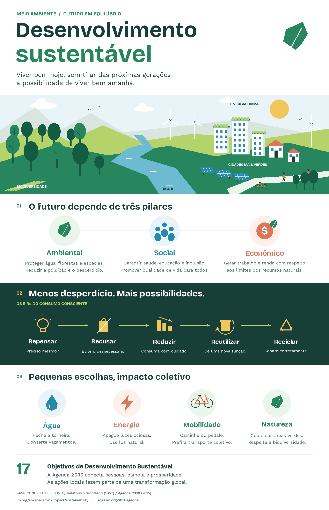

# Infografico-python

  

🌱 Meio Ambiente e Desenvolvimento Sustentável — Infográfico em Python

Tecnologia, programação e consciência ambiental em um só projeto! 🌎💻

Este projeto consiste na criação de um infográfico educativo sobre meio ambiente e desenvolvimento sustentável, desenvolvido em Python com a biblioteca Pillow. A proposta é transformar conceitos ambientais em conteúdo visual acessível, combinando programação, design e educação para incentivar a reflexão sobre práticas sustentáveis no dia a dia.

📌 Sobre o projeto

O infográfico apresenta informações sobre sustentabilidade de maneira didática e visualmente atrativa, facilitando a compreensão de temas importantes para a sociedade e para o futuro do planeta.

🌍 Principais temas abordados:

♻️ Os três pilares da sustentabilidade: ambiental, social e econômico.

🌿 Os 5 Rs da sustentabilidade: repensar, recusar, reduzir, reutilizar e reciclar.

💧 Uso consciente da água: práticas para evitar desperdícios e preservar os recursos hídricos.

⚡ Eficiência energética: atitudes para reduzir o consumo de energia.

🚲 Mobilidade sustentável: alternativas de transporte com menor impacto ambiental.

🌳 Preservação da natureza: valorização da biodiversidade e dos recursos naturais.

🎯 Agenda 2030 da ONU: conexão com os Objetivos de Desenvolvimento Sustentável (ODS).

🎯 Objetivos

O principal objetivo é demonstrar como a programação pode ser utilizada para criar materiais educativos e transmitir informações de forma clara, organizada e visualmente interessante.

Além disso, o projeto busca:

Aplicar conhecimentos de Python na produção de conteúdo visual.

Desenvolver habilidades de organização, composição e apresentação de informações.

Promover a educação ambiental e o consumo consciente.

Compartilhar conhecimento por meio de um projeto público no GitHub.

Incentivar outros estudantes e desenvolvedores a explorar aplicações criativas da programação.

🛠️ Tecnologias utilizadas

Tecnologia

Aplicação

🐍 Python

Linguagem utilizada no desenvolvimento

🎨 Pillow

Criação e composição dos elementos gráficos

🖼️ PNG

Formato de saída do infográfico

📓 Jupyter Notebook

Ambiente opcional para execução e experimentação
🌎 Impactos e contribuições potenciais

📚 Educacional: facilita a apresentação de conceitos ambientais por meio de recursos visuais e linguagem acessível.

🌱 Ambiental e social: incentiva a reflexão sobre consumo consciente, preservação dos recursos naturais e responsabilidade coletiva.

💻 Tecnológico: demonstra uma aplicação prática da programação Python na criação de materiais gráficos educativos.

🤝 Compartilhamento de conhecimento: disponibiliza o código para consulta, estudo, reprodução e possíveis melhorias por outros usuários.

Essas contribuições representam possibilidades educativas do projeto, não resultados de impacto previamente mensurados.

📖 Aprendizados

O desenvolvimento deste projeto permite explorar conceitos como:

Manipulação e composição de imagens com Python.

Organização visual de textos, ícones e elementos gráficos.

Estruturação de informações para comunicação educativa.

Utilização de bibliotecas externas em projetos de programação.

Integração entre tecnologia, criatividade e responsabilidade socioambiental.

♻️ Considerações finais

O projeto Meio Ambiente e Desenvolvimento Sustentável demonstra que a programação vai além da criação de sistemas e aplicações tradicionais: ela também pode ser utilizada como ferramenta de comunicação, conscientização e compartilhamento de conhecimento.

Ao unir Python, recursos visuais e educação ambiental, o infográfico apresenta conceitos importantes de sustentabilidade de forma acessível, reforçando a importância de pequenas atitudes individuais e da responsabilidade coletiva na construção de um futuro mais sustentável.
